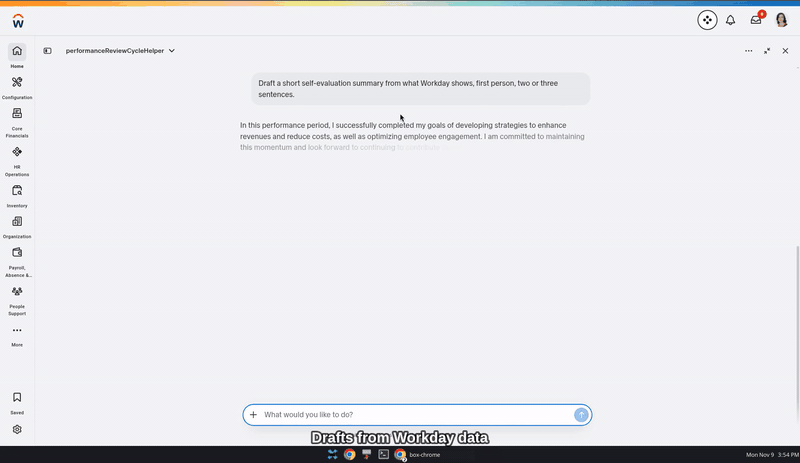
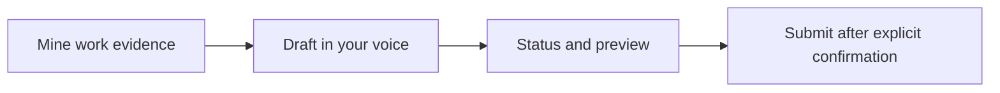

# Performance Review Cycle Helper · Workday MCP

Run your own review cycle in Claude: evidence you opted in to, drafts in your own voice, and a submission only after you confirm.

## Demo

[](https://vimeo.com/1245191425)

[Watch the full demo on Vimeo](https://vimeo.com/1245191425). Real footage from a Workday developer sandbox: the agent reads review status and goals, drafts self-evaluation text from Workday data, then the worker pastes into Complete Self Evaluation and clicks Submit in Workday (UI handoff; no agent submit tool).

## About

Performance Review Cycle Helper is a task-shaped Workday MCP server (stdio) plus Claude skills. It is for employees working through their own review cycle, and for the People and IT teams who run it. It sits in front of a Workday MCP server you already run.

- Shows your review cycle, goals and open feedback requests.
- Collects evidence only from sources you opted in to, only items you authored, inside the review period.
- Drafts your self review or requested feedback in your own voice, with citations.
- Previews the exact submission and submits only after you confirm.
- Runs in fixture mode with invented data, so you can try it without any accounts.

Related: [Internal People Agent](https://github.com/peopletechflow/internal-people-agent) applies the same design to benefits, equity and HR policy, and [workday-mcp-schema](https://github.com/peopletechflow/workday-mcp-schema) is the shared baseline both adapt their security patterns from.

## Main Logic



- **Mine.** `set_evidence_source_opt_in` and `collect_evidence` read only opted-in sources, only a window you choose inside the review period, only items you authored. GitHub is implemented; chat, docs and mail exist as example sources only.
- **Draft.** Claude drafts and you are the author. Citations must match collected evidence. There are no rating, ranking or outcome fields, and drafting rules ban sensitive-trait inference.
- **Preview.** `preview_submission` stores a single-use token bound to you, the draft version and the exact payload. Edits make a new version and invalidate the preview.
- **Submit.** `commit_submission` on the MCP server runs only with `confirm: true` and an idempotency key. Unknown outcomes are never retried automatically; `reconcile_my_submission` checks them. Submitted drafts are locked.
- **App Builder native submit (UI handoff).** The Workday App Builder agent in `agents/` uses `prch-submit-skill` to preview the signed-in worker's own saved Complete Self Evaluation answers, get an explicit yes, then hand off a deep link to that worker's own inbox task so they click Submit in Workday. It does not call submit, advance or skip tools. Employees see only their own review; managers only their team. Native agent files: [agents/](agents/).

**Finding (2026-11-09):** the Workday Developer Agent confirmed that none of the 671 agent-ready MCP tools can submit a performance review self-evaluation. That step is an Initiation step (`d8c892f4446c11de98360015c5e6daf6`) of the Self Evaluation sub-process. `submit_task_type` fails with "not a Tasks type event"; `submit_questionnaire` fails with "Specify a questionnaire response"; the underlying REST is `performanceEnablement` selfEvaluations submit with no MCP wrapper. Submission stays a UI handoff until Workday ships one.

MCP `commit_submission` for self reviews stays gated until mapped through the gateway. Status, capabilities and the full lifecycle: [docs/ARCHITECTURE.md](docs/ARCHITECTURE.md).

### Security

- **Self-scoped reads.** Identity comes from the upstream `identity` capability for your own token. No tool takes identity arguments. Drafts belong to their author, and nothing reads what others wrote.
- **Gated live adapters.** Each capability stays off until it is mapped to one verified upstream tool. Responses are schema-validated.
- **Required Workday security groups.** Employees must reach only their own reviews and managers only their team. Use Self-Service domains with `Employee As Self` for employees and role-based groups such as `Manager` for managers. Never grant `All Employees` on Worker Data domains that hold review or feedback content. Per-tool table and checks: [docs/SECURITY.md](docs/SECURITY.md#required-workday-security).

Full model: [docs/SECURITY.md](docs/SECURITY.md) and [docs/AGENT_GATEWAY_SECURITY.md](docs/AGENT_GATEWAY_SECURITY.md). Report vulnerabilities privately: [SECURITY.md](SECURITY.md).

## Deployment and Install

**Prerequisites:** Node.js 22 or later and pnpm 10. Live mode also needs Postgres and access to an upstream Workday MCP server with your own token.

**Fixture mode** (example data, embedded Postgres, no accounts):

```bash
pnpm install
pnpm check                      # typecheck and tests
FIXTURE_USER=emp_ava pnpm dev   # stdio MCP server
```

For Claude Desktop, run `pnpm build`, use `examples/claude_desktop_config.json` and load `skills/performance-review-cycle-helper/SKILL.md`.

**Live mode (direct mapping):** set `DATABASE_URL`, `WORKDAY_MCP_URL`, `WORKDAY_MCP_TOKEN_FILE` (your own token, `chmod 600`), `WORKDAY_MCP_MAPPING_PATH` (from `examples/workday-mcp-mapping.example.json`) and `ROLE_MAP_PATH`, then run `MODE=live pnpm start`. Optional: `GITHUB_TOKEN_FILE` with your own read-only token, and `GITHUB_REPO_ALLOWLIST`. Direct mapping mode is for MCP servers you run yourself, outside production only.

**Workday App Builder tools:** `examples/workday-app-builder.mapping.json` maps each capability to the tenant-verified App Builder tool names in `src/catalog.ts`. Run `pnpm mapping:check` (read only) to find missing input arguments. Native agent and skills for App Builder live in `agents/` (including `prch-submit-skill`). Status and gaps: [docs/TENANT_METADATA.md](docs/TENANT_METADATA.md). Next steps: [HANDOVER](HANDOVER.md).

**Workday Agent Gateway mode** (the documented Workday path): a Workday operator registers the agent in ASOR, enables its skills, chooses its security groups and activates it. Then run `pnpm asu:login`, `pnpm agent-tools:snapshot`, review and set `AGENT_TOOL_POLICY_PATH`, and run `MODE=live pnpm start`. Steps, env vars and behaviour: [docs/AGENT_GATEWAY_SECURITY.md](docs/AGENT_GATEWAY_SECURITY.md#running-in-agent-gateway-mode).

**CI:** a workflow template is in `docs/ci-workflow.example.yml`. Enabling it needs the `workflow` permission.

More: [HANDOVER](HANDOVER.md), [CHANGELOG](CHANGELOG.md), [AGENTS](AGENTS.md). Contributing: see [CONTRIBUTING.md](CONTRIBUTING.md).

## License

MIT. See [LICENSE](LICENSE).

This software is provided as is, without warranty of any kind. The maintainers and PeopleTech Flow B.V. accept no responsibility or liability for any use, data, HR decisions or outcomes. You are responsible for your own tenant, security and compliance, including your Workday agreements and applicable law.

Independent project, not affiliated with or endorsed by Workday, Inc. Workday is a trademark of Workday, Inc. Verified live in a Workday developer sandbox (App Builder tools and agent skills against the signed-in user's own performance records), not yet in a production tenant. Fixture data is invented.
